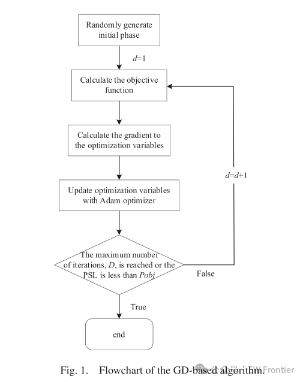
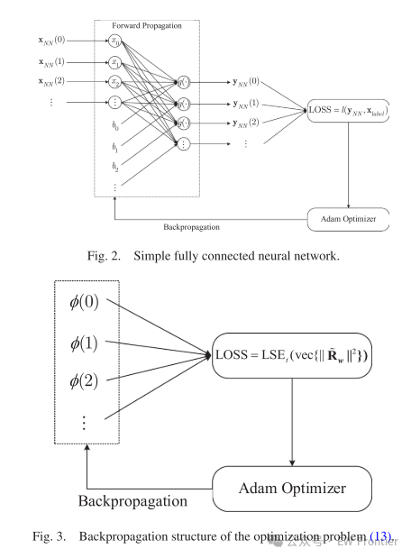
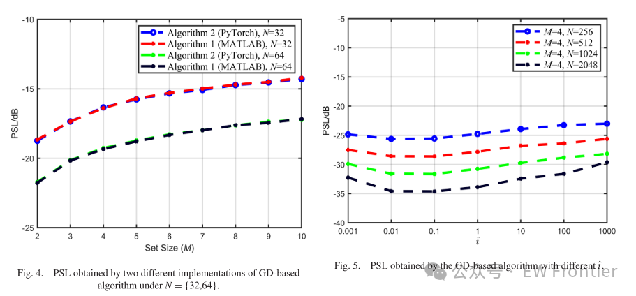
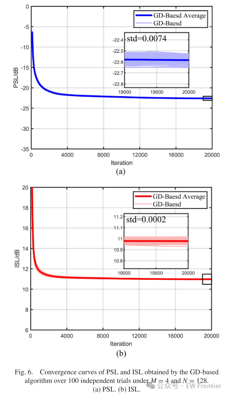
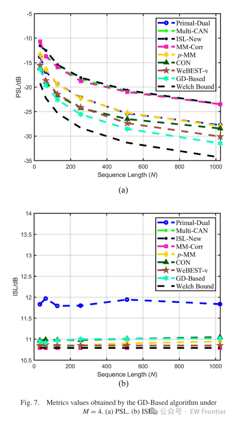
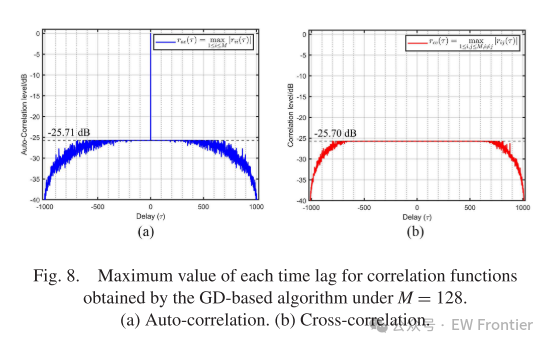
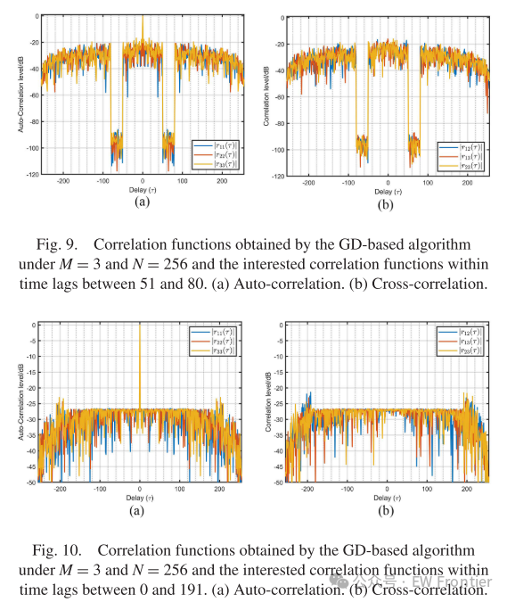

# MIMO Radar - Gradient Descent-Based Neural Network Design for Phase Code Waveforms in MIMO Radar[with Python code]

Introduction  
Compared to traditional single-input single-output (SISO) radars and phased array radars, multi-input multi-output (MIMO) radars have higher degrees of freedom in the transmission waveforms [1]. Waveform diversity technology can significantly enhance the performance of MIMO radars in applications such as target detection [2], tracking [3], imaging [4], [5], jamming suppression, and clutter suppression [6], [7], [8]. The design of orthogonal waveform sets is a prerequisite for MIMO radars to achieve waveform diversity gain. Considering practical applications, constant modulus is the main constraint in waveform design [9].  
Orthogonal waveform sets can be realized through three methods: time division, frequency division, and code division. Both time division and frequency division provide nearly perfect orthogonality. However, time division leads to power loss in the transmitted signal, while frequency division results in high sidelobes at high ranges. In contrast, code division offers larger time-bandwidth product and greater interference resistance [11], [12]. Since the time-bandwidth of actual radar signals is limited, it is impossible to design completely orthogonal phase-coded waveform sets. Therefore, the practical implementation only utilizes approximate orthogonal waveform sets.  
Non-periodic auto- and cross-correlation indicate the orthogonality of phase-coded waveform sets [14], [15]. However, when correlation is mentioned, we imply non-periodic correlation without explicitly mentioning "non-periodic". Standard metrics for evaluating the quality of auto- and cross-correlations within these waveform sets are peak sidelobe level (PSL) [16] and integral sidelobe level (ISL) [17]. Additionally, there are some more precise metrics, such as peak auto-correlation sidelobe ratio (PASR) and peak cross-correlation ratio (PCCR). PCLR also known as peak correlation level (PCL). Although the abbreviation differs, they essentially equal to PSL. To suppress certain regions of the auto-/cross-correlation function, modified weighting factors [18] and modified PCL [19] are mentioned. In this article, normalized PSL and ISL are used as metrics, each with theoretical lower bounds [20], [21].
Several algorithms have been developed to optimize ISL, approaching its lower bound. Loop algorithms (CAN) [18] and extended multi-CAN [22] use loop processes to design waveforms in the frequency domain close to the lower bound of ISL and accelerate operations based on Fast Fourier Transform (FFT). Subsequently, authors in [23], [24], [25], and [26] used optimization minimization (MM) methods to optimize ISL, primarily aiming to accelerate the convergence speed for large-scale waveforms. Compared to MM-Corr [25], the ISL-new algorithm [26] utilizes different optimization functions, resulting in lower or equivalent computational burden per iteration and faster convergence speed. These algorithms can achieve ISL values close to the lower bound but maintain relatively high PSL values.
To optimize PSL, the objective function is typically set as PSL itself, similar to the optimization of ISL. However, the optimization of PSL differs slightly from that of ISL because it is a non-smooth maximization problem. The p-norm model is used to solve this maximization problem [27], [28], [29], [30]. When p → 2, the expression approaches ISL, and when p → ∞, it approaches PSL. In [27], a compact expression for the gradient of the p-norm model of SISO waveforms was proposed, reducing the computational complexity from O(N3) to O(N logN). The dual problem of the PSL optimization problem uses Lagrange multipliers to solve, resulting in lower PSL but higher ISL [28]. In [30], an optimization framework based on block continuous upper bound minimization was proposed to solve the p-norm model, achieving near-optimal PSL and ISL values.
In addition to the p-norm model, some literature has also used alternate projections [31], coordinate descent methods [16], [32], [33], [34], loop algorithms [35] among other traditional optimization algorithms to optimize low PSL continuous or binary sequences.
Various heuristic optimization algorithms have been used in the design of MIMO radar waveform sets, including genetic algorithms [36] and greedy algorithms [37]. However, when applied to long sequences, these algorithms often have a longer running time [36], [37], [38], [39]. With the rapid development of neural networks in the field of artificial intelligence, some researchers have explored using neural networks to solve the problem of waveform set design [40], [41], [42], [43], [44], [45], [46]. The Convolutional Neural Network (CON) based on residual blocks for comprehensive optimization network (CON) training through unsupervised learning to minimize the loss function that combines the weighted sum of PSL and ISL. This method has yielded favorable results, especially when dealing with long sequences. It is worth noting that although the results of [46] indicate the feasibility of using neural networks for waveform set design, this method lacks convincing theoretical foundations. In the context of waveform set design problems, common terms such as "samples" and "training" in classification recognition do not have direct equivalents.
Neural networks and gradient descent (GD) share similarities in waveform design [27], [30], [47], [48], [49], [50], because both methods use GD to seek local optima. Inspired by the application of GD in solving large-scale non-convex optimization problems in neural networks, this paper proposes a low PSL orthogonal waveform set design algorithm based on GD.
The contributions of this paper are threefold.
1) Unlike the p-norm model, we use logarithmic and exponential (LSE) functions as smooth approximations to the max function [51], [52], [53], thereby creating a smooth objective function to replace the non-differentiable PSL. At the same time, the LSE technique can avoid numerical overflow during the calculation process without losing computational accuracy.
2) Subsequently, we developed an optimization based on GD (Algorithm 1), and utilized the Adam optimizer [54] to minimize this unconstrained approximate optimization problem, thus reducing the likelihood of converging to a local minimum.
3) Furthermore, the connection between GD-based algorithms and neural network optimization is clarified, enabling the leveraging of backpropagation structures for GD-based algorithms (Algorithm 2). Mature software frameworks [55], [56], [57] can be used to reduce programming work. Meanwhile, automatic differentiation modules in neural networks facilitate rapid gradient computation [58], [59], [60], [61], thereby reducing computation time while maintaining equivalent PSL performance.
Numerical results show that the proposed algorithm can design waveform sets with PSL values lower by 1-2 dB than existing waveform design algorithms, while achieving near-lower bound ISL values, demonstrating high computational efficiency.
Article illustrations
Conclusion
Inspired by neural networks, this paper proposes a GD-based orthogonal phase encoding waveform set design algorithm. The proposed method utilizes a first-order GD algorithm to minimize the objective function approximated by the LSE function. Additionally, the algorithm clarifies its connection with neural networks, making it compatible with mature software frameworks and significantly reducing programming work. Numerical results highlight the capability of the algorithm to optimize large-scale waveform sets, achieving lower PSL values by 1-2 dB compared to state-of-the-art algorithms while maintaining ISL close to its lower bound. The algorithm exhibits good stability, and due to its rapid optimization speed, it also provides practicality.
End

## Images

<!-- PAYMENT_BLOCK -->

## Get this dataset

- Payment link (Stripe): [Buy now](https://buy.stripe.com/3cs8yP7sY87d0vu9AB)
- Payment QR code: 

<!-- /PAYMENT_BLOCK -->
